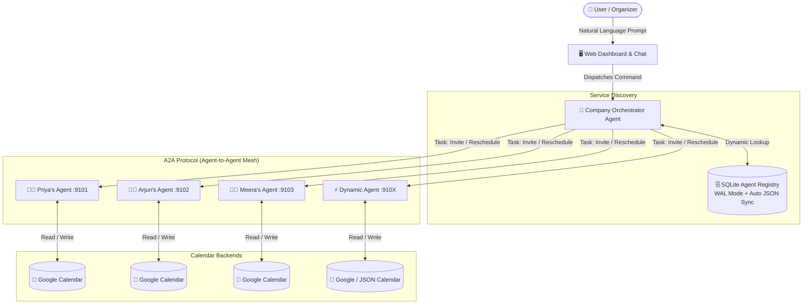
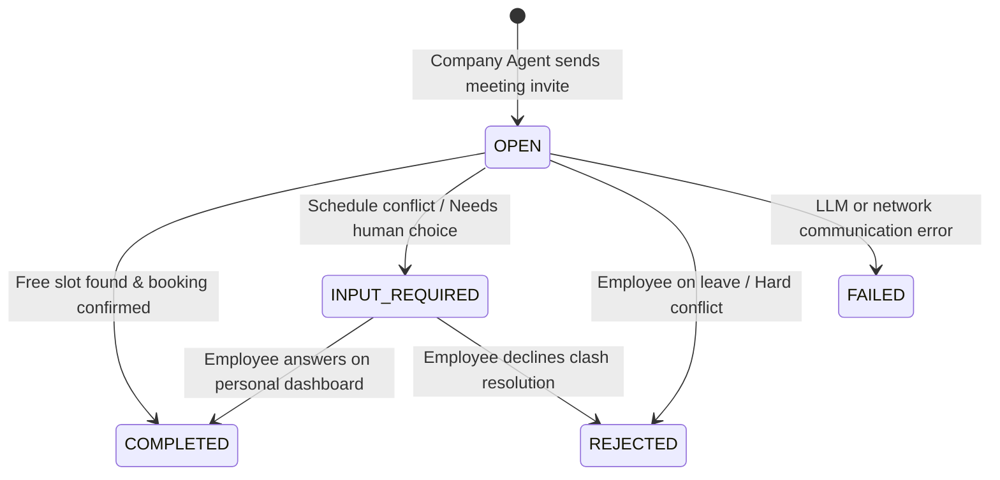

# ⚡ Gather A2A — Autonomous Multi-Agent Meeting Scheduler

<div align="center">

[](https://python.org)
[](https://github.com/google/a2a)
[](https://groq.com)
[-003B57?style=for-the-badge&logo=sqlite&logoColor=white)](https://sqlite.org)
[](https://developers.google.com/calendar)
[](test_agent_registry.py)

**Autonomous AI agents negotiating, resolving calendar clashes, and scheduling meetings over Google's open Agent-to-Agent (A2A) protocol.**

[Features](#-key-features) • [Architecture](#-architecture) • [Quick Start](#-quick-start-in-2-minutes) • [Web Dashboard](#-interactive-web-dashboard) • [Tests](#-automated-testing)

</div>

---

## 🌟 The Vision

Scheduling a meeting across multiple people is notoriously painful: endless back-and-forth emails, calendar conflicts, time zone confusion, and double bookings.

**Gather A2A** replaces manual scheduling with **cooperating autonomous agents**:
1. You tell the **Company Orchestrator Agent**: *"Schedule an urgent Q3 review with Priya and Arjun for next Tuesday afternoon."*
2. The Company Agent looks up registered employees in the **Dynamic Agent Registry**.
3. It initiates peer-to-peer **A2A negotiation tasks** with Priya's and Arjun's personal calendar agents.
4. Each employee agent autonomously inspects its owner's real-world schedule, detects clashes, negotiates alternatives, or flags questions to its owner on their private dashboard.
5. Once all parties agree, the event is atomically booked on their **Google Calendars**!

---

## 🏗️ Architecture



### 🔄 A2A Task State Machine
Every inter-agent conversation adheres to strict protocol lifecycle states:



| State | Trigger | Outcome |
|---|---|---|
| `COMPLETED` | Employee free / conflict resolved | Event booked on owner's calendar with unique meeting ID artifact. |
| `INPUT_REQUIRED` | Clash detected / partial match | Task pauses; employee is prompted on their private dashboard. |
| `REJECTED` | Out of office / decline | Company agent notifies organizer and rolls back or marks partial. |
| `FAILED` | Tool error / communication failure | Supervisor auto-recovers; error surfaced gracefully. |

---

## ✨ Key Features

- **🤖 True Multi-Agent A2A Collaboration**: Built on Google's `a2a-sdk` standard. Agents are distributed microservices communicating asynchronously over HTTP with structured Agent Cards.
- **🧠 Human-in-the-Loop Decision Center**: When conflicts arise, tasks pause in `INPUT_REQUIRED`. Employees review and approve/counter proposed times on their individual dashboards without cluttering the organizer's chat.
- **🗄️ SQLite Dynamic Agent Registry**:
  - Zero hardcoding: Employee agents are discovered dynamically via a persistent SQLite database with WAL mode and atomic commits.
  - LLM instructions are dynamically primed with current employees through tool queries.
  - Role-based permissions (Administrator/Organizer profile can register/unregister; employee profiles are strictly read-only).
- **📅 Dual Calendar Backends**:
  - **Google Calendar OAuth 2.0**: Live, production-ready synchronization with shared secondary calendars.
  - **Mock / Simulator Mode**: Offline JSON calendar engine for rapid local development and end-to-end testing with zero external dependencies.
- **🛡️ Self-Healing Process Supervisor**: `run_all.py` acts as an orchestration supervisor that launches all microservice agents and the web dashboard, automatically reviving any crashed agent in the background.
- **🎨 Glassmorphic Modern Web UI**: Responsive dashboard featuring real-time event feeds, visual calendar timelines, employee profile switching, and an interactive chat console.

---

## 🚀 Quick Start in 2 Minutes

### 1. Clone & Setup Environment
```bash
git clone https://github.com/your-username/a2a-meetings.git
cd a2a-meetings

# Create and activate virtual environment
python -m venv .venv
source .venv/bin/activate       # On Windows: .venv\Scripts\activate

# Install dependencies
pip install -r requirements.txt
```

### 2. Configure API Keys
Copy the example environment configuration:
```bash
cp .env.example .env
```
Open `.env` and add your [Groq API Key](https://console.groq.com/keys):
```env
GROQ_API_KEY=gsk_your_groq_api_key_here
GROQ_MODEL=openai/gpt-oss-120b
CALENDAR_BACKEND=fake           # Set to 'google' for real Google Calendar sync
```

### 3. Launch with Self-Healing Supervisor
Start all microservices and the web dashboard in one single command:
```bash
python run_all.py
```

Open your browser at **[http://127.0.0.1:8080](http://127.0.0.1:8080)**!

---

## 🖥️ Interactive Web Dashboard

| View | Purpose |
|---|---|
| **💬 Executive Chat** | Converse in natural language (*"Book a sprint retro with Arjun and Meera on Thursday at 3 PM"*). |
| **📅 Company Schedule** | Real-time consolidated view of all company meetings with filtering by attendee. |
| **👤 Employee Profiles** | `/employees/<name>` — Individual employee dashboard showing personal calendar and pending conflict questions. |
| **🗄️ Agent Registry** | `/registry` — Live catalog of registered A2A agents with latency pinging, status badges, and admin provisioning controls. |
| **📜 Audit Feed** | Live stream of A2A protocol events, state transitions, and booking confirmations. |

---

## 🧪 Automated Testing

Gather A2A includes a comprehensive automated test suite ensuring rock-solid stability across agent networking, database transactions, concurrency, and calendar operations:

```bash
# Run entire test suite (104 tests)
python -m unittest discover -s . -p "test_*.py"
```

```text
........................................................................................................
----------------------------------------------------------------------
Ran 104 tests in 1.482s

OK
```

---

## 📁 Repository Layout

```text
├── agents/
│   ├── company_agent.py        # Company Orchestrator Agent (A2A Client)
│   ├── company_tools.py        # Orchestrator tool schemas & meeting operations
│   ├── employee_agent.py       # Distributed Employee Agent server
│   ├── employee_tools.py       # Calendar conflict checking & booking tools
│   ├── agent_registry.py       # SQLite dynamic service directory
│   ├── calendar_backend.py     # Google Calendar OAuth & JSON simulator backends
│   ├── common.py               # Shared A2A helpers & agent card generators
│   └── llm.py                  # Groq / OpenAI LLM loop integration
├── data/
│   ├── agent_registry.db       # Persistent SQLite registry with WAL mode
│   ├── meetings.json           # Active company meetings store
│   └── calendars/              # Local calendar event files (Simulator mode)
├── ui/
│   └── index.html              # Modern glassmorphic SPA web dashboard
├── web_ui.py                   # FastAPI / Starlette backend web server
├── run_all.py                  # Supervisor to manage and auto-heal all processes
└── test_*.py                   # 100+ unit, integration, and mock test suites
```

---

## 💡 Engineering Highlights & Learnings

- **Protocol Idempotency**: Meeting operations are keyed by deterministic meeting IDs, ensuring concurrent retries and A2A network blips never produce duplicate calendar entries.
- **Safe Isolation**: SQLite transactions use WAL (`Write-Ahead Logging`) with atomic write patterns to protect database integrity across multi-threaded operations.
- **Non-blocking Auth**: OAuth consent flows are kept decoupled from web dashboard threads, preventing server lockups during interactive authorization.

---

## 📄 License

Distributed under the **MIT License**. See `LICENSE` for details.
